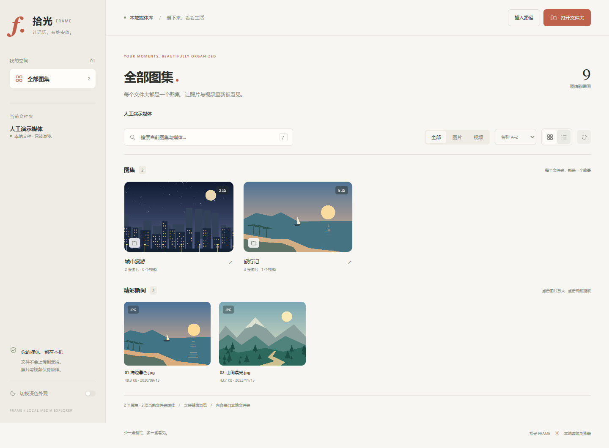

# 拾光 Frame · 本地媒体浏览器

**CS3331 软件工程作业**。使用 Python 标准库提供本机 HTTP 后端，使用原生 HTML、CSS、JavaScript 实现前端。打开一个本地文件夹后，子文件夹会成为图集，可以逐层进入图集、浏览图片及播放视频。应用代码不依赖第三方包，不需要安装 Node.js 或前端构建工具。

## 快速启动

需要 Python 3.10 或以上版本。本作业在 Windows 上使用 `cheshi_handedit` 环境；不使用 MSYS 的默认 Python。

1. 双击 `start.bat`：在后台启动服务，并在默认浏览器打开页面。
2. 点击页面中的“打开文件夹”，在系统对话框中选择本地媒体目录。
3. 点击图集进入子文件夹；点击图片或视频打开查看器。

默认地址为 **http://127.0.0.1:8877**。需要查看启动错误或停止服务时，使用 `run-console.bat`，按 `Ctrl+C` 结束。后台启动后也可以在任务管理器中结束对应的 `pythonw.exe` 进程。请避免重复启动占用同一端口的实例。

也可以从项目目录运行：

```powershell
& "$env:USERPROFILE\miniconda3\envs\cheshi_handedit\python.exe" app.py
& "$env:USERPROFILE\miniconda3\envs\cheshi_handedit\python.exe" app.py --root "D:\Photos"
& "$env:USERPROFILE\miniconda3\envs\cheshi_handedit\python.exe" app.py --port 8878 --no-browser
```

`--root` 指定初始目录；`--demo` 打开项目下的 `demo-media`；`--port` 更改监听端口（`0` 由系统分配）；`--no-browser` 禁止自动打开浏览器；`--verbose` 输出简要请求日志。`run-console.bat` 也接受这些参数，例如 `run-console.bat --root "D:\Photos"`。

原生目录选择器使用独立的 Tk 子进程，最多等待 90 秒。系统没有 Tk、对话框启动失败或超时，仍可使用页面的手动路径入口输入本地绝对路径。取消选择会保留当前图集。

## 浏览体验与支持格式

- 文件夹按图集显示，并提供封面及媒体数量；支持嵌套图集与路径导航。
- 图片和视频统一展示在媒体网格中，使用查看器放大浏览或播放。
- 前端提供搜索、筛选及排序入口；媒体按需加载，布局适应桌面及窄屏。
- 页面在空图集、权限不足、文件删除或移动时显示相应状态。

| 类型 | 识别的扩展名 |
| --- | --- |
| 图片 | `.jpg`、`.jpeg`、`.png`、`.gif`、`.webp`、`.avif`、`.bmp` |
| 视频 | `.mp4`、`.webm`、`.mov`、`.m4v`、`.ogg`、`.ogv` |

扩展名识别不等于浏览器能够解码。AVIF、MOV 及某些视频编码的支持取决于浏览器和系统；后端不会转码。对常见浏览器，H.264 编码的 MP4 通常更便于播放。后端实现单段 HTTP `Range`、`206 Partial Content`、`416 Range Not Satisfiable` 及 `HEAD`，供视频播放器拖动进度和获取文件信息。未知范围单位和多段范围请求按完整 `200` 响应处理，`HEAD` 忽略范围。

## 离线演示素材

演示图片由代码绘制为风景插画，视频由同一离线素材生成；没有联网下载或用户私人照片。先生成素材，再打开演示：

```powershell
& "$env:USERPROFILE\miniconda3\envs\cheshi_handedit\python.exe" scripts/generate_demo.py
& "$env:USERPROFILE\miniconda3\envs\cheshi_handedit\python.exe" app.py --demo
```

生成脚本本身只使用 Python 标准库。检测到 `ffmpeg` 时生成 JPG 图片及一个约 4 秒的 H.264 MP4；也可通过 `--ffmpeg "D:\Tools\ffmpeg.exe"` 指定可执行文件。没有 FFmpeg 时生成浏览器可查看的 BMP 图片，跳过视频。`--no-video` 只生成图片，`--output` 指定输出目录。FFmpeg 仅用于生成可选演示素材，应用运行不需要它。

演示包含根目录图片、两个图集、嵌套图集及视频。`demo-media/` 被忽略，不会提交生成的二进制文件；通过脚本可重新生成。

## 前后端接口

前端和后端由同一个本机服务提供，没有远程服务依赖。接口路径中的媒体路径相对于当前根目录，使用 `/` 分隔并进行 URL 编码。

| 请求 | 用途与参数 |
| --- | --- |
| `GET /api/bootstrap` | 返回 `token`、`session`、当前 `root`、名称、目录选择器状态和支持格式。 |
| `GET /api/library?path=&session=...` | 读取根图集；`path` 可指定子图集。返回 `albums`、`media`、扫描警告和扫描时间。 |
| `POST /api/root` | JSON `{ "path": "D:\\Photos", "session": "..." }`；切换根目录并返回新的会话。 |
| `POST /api/picker` | JSON `{ "session": "..." }`；打开原生目录选择器，返回新会话或 `cancelled: true`。 |
| `GET /media/{session}/{path}` | 读取图片或视频；支持单段 `Range` 请求。 |
| `HEAD /media/{session}/{path}` | 返回完整媒体响应头，不发送文件内容；忽略 `Range`。 |

两个 POST 接口必须使用 `Content-Type: application/json` 和 `X-App-Token` 请求头，其值来自启动信息。切换根目录会更换 `session`；旧图集请求和旧媒体地址返回 `409 stale_session`，防止同时打开的页面混用目录。错误响应使用 `{ "error": "中文说明", "code": "错误标识" }`。

后端可供测试或嵌入调用的入口：

```python
from app import create_server

server = create_server(host="127.0.0.1", port=8877, root=None, verbose=False)
try:
    server.serve_forever()
finally:
    server.server_close()
```

## 本地文件与安全边界

媒体只在本机读取、通过本机 HTTP 返回给浏览器，文件不上传，应用没有删除、修改或移动媒体的接口。服务只允许监听 `127.0.0.1`，并检查 Host、Origin 和跨站请求来源；根目录切换有随机操作凭据和会话校验。

媒体访问限制在所选根目录内，拒绝绝对媒体路径、`..`、反斜杠、盘符及越界路径，扫描时跳过符号链接和目录联接。静态资源使用固定清单，任意工程文件不会由静态路由暴露。浏览器内容采用同源限制，文件名作为文本显示。

这是供当前电脑使用的作业应用，同机其他有权限的程序仍可调用本机服务。图集的递归数量及封面统计采用 100000 项预算，达到上限时会返回不完整计数提示；当前层级的列表使用独立的 100000 项上限，大图集耗尽统计预算不会隐藏同层其他入口。本层条目本身超过上限时，列表也会截断并显示提示。程序不监视文件系统，目录发生变化后使用刷新操作重新读取。

## 项目结构与验证

```text
media-browser/
├─ app.py                 # 本机 HTTP 服务、目录扫描、媒体分段读取
├─ static/                # HTML、CSS、JavaScript 与图标
├─ scripts/generate_demo.py
├─ start.bat              # Windows 后台启动
├─ run-console.bat        # Windows 可查看日志的启动入口
├─ tests/                 # 测试工程师编写的自动化测试
└─ docs/                  # 评审、测试及 Agent Team 开发过程记录
```

开发流程为 CodeWriter 实现、CodeReviewer 评审、TestEngineer 编写并执行测试，发现问题后回到 CodeWriter 修复并重新验证。测试覆盖范围、执行结果、修复记录和浏览器检查以 `docs/` 中的交付报告为准；本文不代替测试执行记录。

自动化测试使用作业指定的 Python 环境运行：

```powershell
& "$env:USERPROFILE\miniconda3\envs\cheshi_handedit\python.exe" tests/run_tests.py
```

浏览器验收另需 Node.js、Playwright 与 Edge/Chrome，完整复现命令见测试报告。应用运行无需这些测试工具。

交付索引：

- [完整交付报告](docs/FINAL_REPORT.md)
- [完整测试报告](docs/TEST_REPORT.md)：用例、执行环境、原始成功/失败输出与限制。
- [独立代码评审](docs/CODE_REVIEW.md)：首轮问题与两轮修补复评。
- [Agent Team 开发日志](docs/DEVELOPMENT_LOG.md)与[博客稿](docs/BLOG_DRAFT.md)：实际分工、发现的问题和经验。
- [源码测试](tests/)与[GitHub 自动验证](.github/workflows/tests.yml)。

## 界面预览

下图只包含离线生成的人工演示素材。



窄屏与查看器截图见 [docs/screenshots](docs/screenshots/)。
